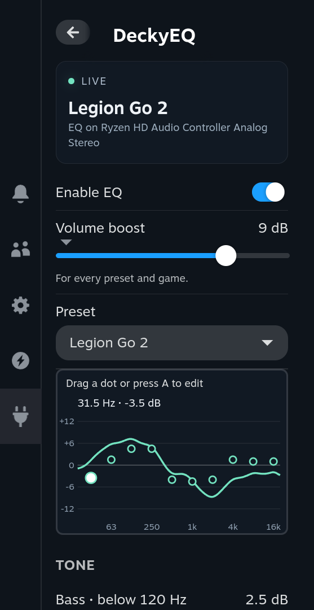
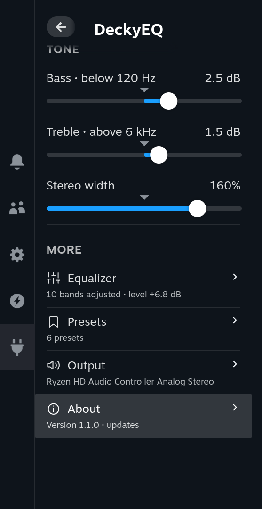
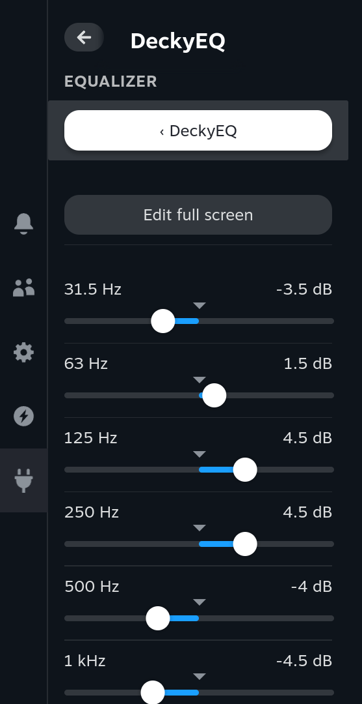
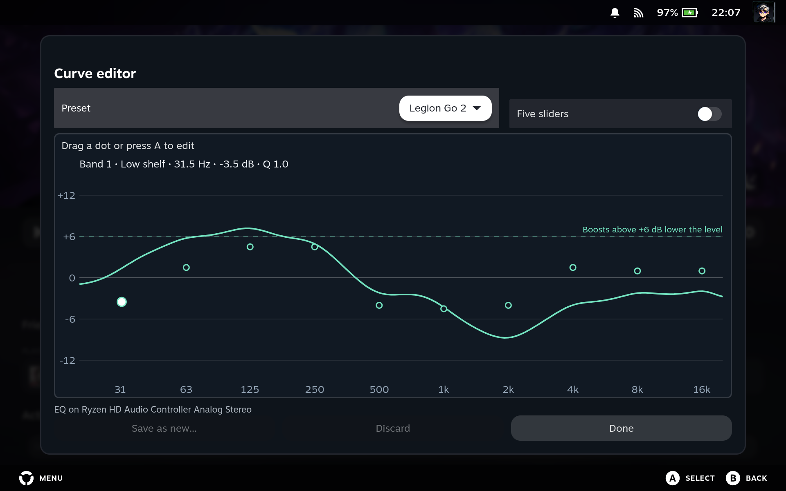
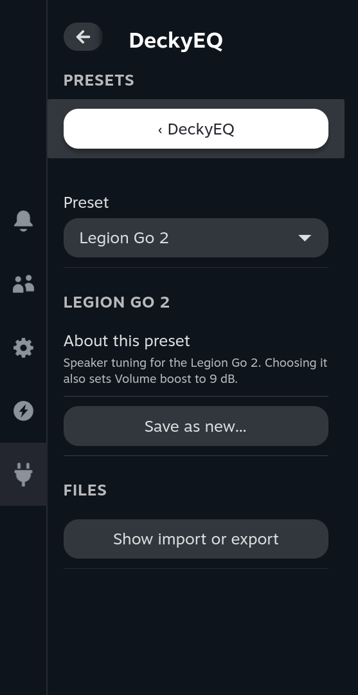
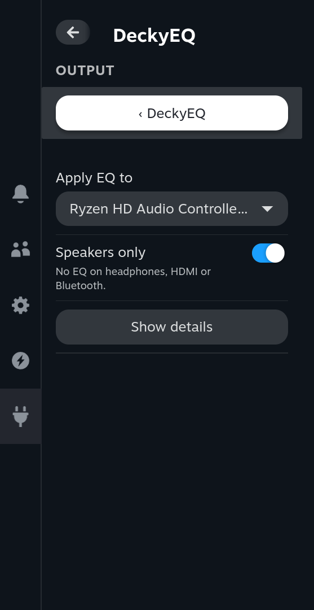
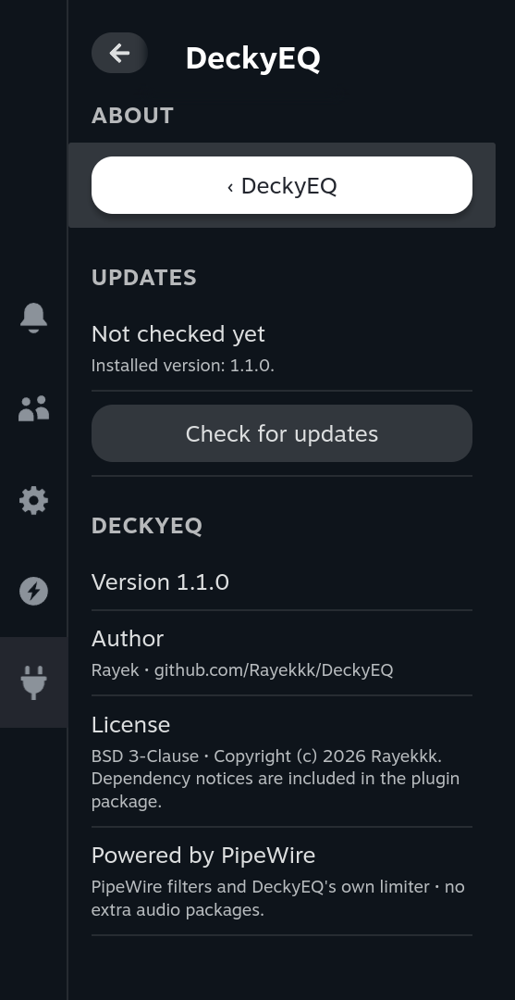

<div align="center">


[](https://github.com/Rayekkk/DeckyEQ/releases/latest)
[](https://github.com/Rayekkk/DeckyEQ/releases)
[](#requirements)
[](https://decky.xyz)
[](LICENSE)

**Shape your sound, band by band, in the Steam overlay.**
A live equalizer, bass and treble, volume boost, your own presets and a sound per game, without leaving Gaming Mode.

[Features](#features) · [Requirements](#requirements) · [Installation](#installation) · [Quick start](#quick-start) · [Using DeckyEQ](#using-deckyeq) · [Troubleshooting](#troubleshooting) · [How it works](#how-it-works) · [AI disclaimer](#ai-disclaimer)

</div>

---

## Features

An equalizer makes some parts of the sound louder or quieter: the deep bass, the voices
in the middle, or the bright detail at the top. DeckyEQ does this for everything your
console plays, live while you listen. Steam's volume slider, the volume buttons and
Steam's output choice keep working exactly as before. It uses the audio system already in
SteamOS (PipeWire): there is nothing extra to install and it does not need root.

| Feature | What you can do |
|---|---|
| [Main screen](#main-screen) | Turn EQ on, raise the volume with **Volume boost**, pick a preset and set **Bass**, **Treble** and **Stereo width** |
| [Equalizer](#equalizer) | Ten band sliders from deep bass to treble, or **Five sliders** that each move two neighbouring bands |
| [Curve editor](#curve-editor) | Drag the dots of the curve with touch or the controller, in the menu or full screen |
| [Presets](#presets) | Start from five built-in sounds, save up to 64 of your own, and import or export them as files |
| [Per-game sound](#per-game-sound) | Give a game its own sound that comes back whenever it runs |
| [Output](#output) | Choose the output that gets EQ; **Speakers only** keeps it off headphones, HDMI and Bluetooth |
| [About](#about) | See the version and download verified updates from GitHub |

A limiter always guards the output, so a boost turns loud peaks down smoothly instead of
crackling. Your latest edits are kept when you close the menu or restart Decky.

## Requirements

| Requirement | Details |
|---|---|
| Device | Built for SteamOS handhelds; tested on the **Lenovo Legion Go 2** only |
| System | SteamOS in Gaming Mode with [Decky Loader](https://decky.xyz) (tested on SteamOS 3.9.5 with Decky Loader 3.3.0) |
| Audio | PipeWire with WirePlumber 0.5 or newer, as in SteamOS 3.7 and newer (tested on PipeWire 1.6.8 and WirePlumber 0.5.18) |
| Extra packages | None: `pipewire`, `pw-cli`, `pw-dump`, `pactl` and `python3` come with SteamOS; no EasyEffects or other audio plugins |
| Internet | Only to check for and download updates |

On the Legion Go 2 the audio routing, live changes, the untouched volume and output, the
limiter, behaviour after a crash and the CPU use (none while nothing plays) were measured,
and EQ was checked by ear in Gaming Mode. Headphone and Bluetooth changes, sleep and
resume, longer listening and per-game sound have not been checked on the device yet. Other
handhelds have not been tested. The [validation record](docs/VALIDATION.md) has the details.

## Installation

1. Install [Decky Loader](https://decky.xyz) if you do not already have it.
2. Download `DeckyEQ-<version>.zip` from [Releases](https://github.com/Rayekkk/DeckyEQ/releases/latest).
3. In Gaming Mode, open **Quick Access Menu → Decky → Settings** and turn on **Developer mode** under **General**.
4. Open **Developer**, choose **Install Plugin from ZIP** and select the archive.
5. Open **DeckyEQ** in Decky and turn on **Enable EQ**.

No terminal commands are needed.

**Rayek's store:** **About → Use Rayek's store** sets Decky's store channel to Rayek's store
(`https://decky.rayek.workers.dev`) after you confirm, so Decky's **Store** tab lists Rayek's plugins and offers
their updates. Plugins from the official store stay installed, but get no update offers while it is selected;
switch back in **Decky Settings → General → Store channel → Default**.

### Updating

1. Open **About → Check for updates**.
2. Choose **Download &lt;version&gt;**; the ZIP appears in your Downloads folder.
3. Install it through **Decky Settings → Developer → Install Plugin from ZIP**.

DeckyEQ never installs anything by itself, and it contacts GitHub only when you press a
button. If the repository has no release yet, About says **No public release yet**.

<details>
<summary><b>How updates are checked</b></summary>

Only stable releases are offered, and only a `DeckyEQ-X.Y.Z.zip` that a GitHub Actions run in
this repository uploaded to the release. Before the ZIP is saved,
DeckyEQ checks its SHA-256 digest, size, contents, plugin name and version. The digest proves
the file arrived intact, not who built it; `gh attestation verify DeckyEQ-X.Y.Z.zip --repo Rayekkk/DeckyEQ`
shows that GitHub Actions built it from this repository. A failed download never leaves a
half-written ZIP behind.

</details>

<details>
<summary><b>Updating from 1.0</b></summary>

- The **Automatic headroom** switch is gone: headroom is always on and now lowers the level
  only for EQ boosts above +6 dB. Most presets play louder than in 1.0; presets that had the
  switch off may play slightly quieter (the Go S preset by about 0.6 dB).
- A band's frequency can no longer be changed. A band you moved in 1.0 keeps its own
  frequency and is named by it; only its gain (in full screen also its width and type) changes.
- Going back to 1.0 later may fail to read settings that use stereo width or other 1.1-only
  settings. Export your presets first.

[CHANGELOG.md](CHANGELOG.md) lists everything that changed.

</details>

### Uninstalling

Remove DeckyEQ in **Decky Settings → Plugins**. Playback goes straight to your output again at
the same volume; nothing has to be restored. Exported preset files in `~/Documents/DeckyEQ/` stay.

## Quick start

Open DeckyEQ in Decky. The card at the top shows whether EQ is **Live**, which preset plays
and on which output.

<a href="docs/screenshots/overview.png"></a>

1. Turn on **Enable EQ**. DeckyEQ picks your speakers; if it cannot, choose them under **Output**.
2. Pick a **Preset**. On a Legion Go 2, start with **Legion Go 2**; elsewhere try **Clear voices** or **More bass**.
3. Play something you know well and adjust **Bass**, **Treble** or the dots on the curve.
4. If the speakers are too quiet at full volume, raise **Volume boost**.
5. To keep your sound, choose **Save** (**Save as new…** for a built-in preset).

The screenshots in this guide show the Quick Access panel at full size: click one to open it.

## Using DeckyEQ

### Main screen

The main screen holds what you use every day:

- **Enable EQ** turns the equalizer on and off.
- **Volume boost** (0 to +12 dB) makes everything louder, for every preset and game. Use it
  when the speakers are too quiet at full volume.
- **Preset** chooses the sound. The curve below it shows what the preset does, and you can
  edit it right there (see [Curve editor](#curve-editor)).
- **Bass** (below 120 Hz) and **Treble** (above 6 kHz) go from -9 to +9 dB.
- **Stereo width** goes from 0% (mono) through 100% (unchanged) to 200% (twice as wide).

While the sound has unsaved changes, **Save** (**Save as new…** for a built-in preset) and
**Discard** appear below the sliders. Under **More**, each row shows a short summary and
opens a page; **B** goes back one page.

<a href="docs/screenshots/tone-more.png"></a>

### Equalizer

**Equalizer** has one slider per band: 31.5 Hz, 63 Hz, 125 Hz, 250 Hz, 500 Hz, 1 kHz, 2 kHz,
4 kHz, 8 kHz and 16 kHz, each from -12 to +12 dB. Low numbers are bass, the middle is voices,
high numbers are treble. Every preset uses the same ten bands, so the sliders stay the same
whichever preset you pick.

<a href="docs/screenshots/equalizer.png"></a>

- **Input level** raises or lowers the sound before the equalizer. When big boosts need room,
  the line under it says how much DeckyEQ lowered it.
- **Five sliders** shows five sliders instead of ten; each moves two neighbouring bands
  together. Switching never changes your sound, and the choice belongs to this console, not
  to a preset.
- **Reset to flat** returns the bands, bass, treble, stereo width and input level to their
  defaults; **Volume boost** stays.

### Curve editor

The curve shows what all bands and the tone sliders do together. Its dots move only up and
down: drag one with your finger, or move to the curve and press **A**.

| Control | Action |
|---|---|
| A | Start editing |
| D-pad left / right | Choose the band (or pair, with **Five sliders**) |
| D-pad up / down | Change its gain in 0.5 dB steps |
| X | Set it flat |
| LT / RT (full screen) | Make the band wider or narrower |
| Y (full screen) | Change its filter type |
| B | Finish editing |

**Edit full screen** on **Equalizer** shows the same curve larger, with the preset list,
**Five sliders**, **Save**, **Discard** and **Done**.

<a href="docs/screenshots/curve-editor.png"></a>

<details>
<summary><b>Filter types and band details</b></summary>

A **bell** lifts or cuts the sound around its frequency, a **low shelf** everything below it
and a **high shelf** everything above it. A wider band affects more of its neighbours. Above
the graph you see the chosen band's frequency and gain, and while editing also its type and Q
(its width).

A band's frequency cannot be changed. A band slightly off its usual frequency (the Go S
file's 31.25 Hz) moves there when you edit it. A band that DeckyEQ 1.0 moved, or an imported
one, keeps its own frequency and is named by it. In full screen a dashed line marks +6 dB: boosts above it
lower the level (see [How it works](#how-it-works)).

</details>

### Presets

**Presets** shows the chosen preset with **About this preset**, and the actions for it:
**Save**, **Discard**, **Save as new…**, and for your own presets **Rename…** and **Delete**.
You can save up to 64 presets.

<a href="docs/screenshots/presets.png"></a>

| Built-in preset | What it does |
|---|---|
| Flat | No change |
| Clear voices | Brings dialogue forward: a little less boom, more presence around 2–4 kHz |
| More bass | A fuller low end where small speakers can still play it, around 100–250 Hz |
| Legion Go S | GAZuOOT's community speaker preset for the Legion Go S, with its +8 dB input boost |
| Legion Go 2 | Speaker tuning for the Legion Go 2, made by ear from the Legion Go S preset; choosing it also sets **Volume boost** to 9 dB |

Built-in presets cannot be overwritten, but you can edit them and keep the result with
**Save as new…**. The **Legion Go S** preset is community tuning, not a measured calibration;
the [preset notes](docs/GO_S_PRESET.md) list its exact settings. If it sounds squashed, lower
**Input level**.

**Show import or export** offers:

- **Import presets…**: adds presets from a DeckyEQ JSON file in your home folder (up to 256 KiB).
  It never overwrites a preset or changes what plays. EasyEffects and Equalizer APO files need
  converting first.
- **Export this sound**: the sound playing now, including unsaved edits.
- **Export your presets**: all the presets you saved.
- **Export this sound to…**: the sound playing now, into a folder you choose.

Exports go to `~/Documents/DeckyEQ/` and never overwrite an existing file.

### Per-game sound

While a game runs, the main screen shows **Own sound for &lt;game&gt;**. Turn it on and the
preset and slider changes you make from then on belong to that game only. When the game
closes, your everyday sound returns; the game's sound comes back the next time it runs.

**Volume boost** and the output settings stay the same for every game. **Presets → Games with
their own sound** lists the games, each with a **Forget** button. Up to 200 games are kept.
Exports carry presets only, never game sounds.

### Output

**Apply EQ to** chooses the output that gets EQ, normally the speakers. **Speakers only** (on
by default) leaves EQ off when that output plays through headphones, HDMI or Bluetooth.
Turn it off to use EQ on a headset as well.

<a href="docs/screenshots/output.png"></a>

**Show details** shows Steam's current output and offers **Reconnect EQ**. While EQ is on,
Steam also lists **DeckyEQ** as an output; choosing it is the same as choosing the output EQ
applies to.

### About

**About** shows the installed version, author and licence, and checks for updates as
described in [Updating](#updating).

<a href="docs/screenshots/about.png"></a>

## Troubleshooting

| What you see | What to do |
|---|---|
| **Standby** | Steam plays to another output, for example Bluetooth headphones. EQ waits; choose that output under **Output** if you want EQ there. |
| **Bypassed** | **Speakers only** is on and the output is not on its speakers, for example with headphones plugged in. Turn **Speakers only** off to use EQ there. |
| **Waiting for output** | The chosen output is gone. Reconnect it or choose another one under **Output**. |
| **Paused** | Read the reason, check **Output**, then use **Reconnect EQ** under **Show details**. |
| **Unavailable** | A system tool or the audio session is missing; the reason is shown. On the tested stock SteamOS every tool was already there. |
| The sound is too quiet | Raise **Volume boost** or **Input level**. Only EQ boosts above +6 dB lower the level. |
| The sound is squashed or pumps | The limiter is working hard. Lower **Input level** or **Volume boost**; more gain past that point only compresses the sound. |
| Steam lists **DeckyEQ** as an output | Normal while EQ is on. Choosing it is the same as choosing the output EQ applies to. |
| **Own sound for** is missing | It appears only while a game runs. |
| My edits are not in the exported presets | **Export your presets** contains saved presets. Save first, or use **Export this sound**. |
| A file from another equalizer is refused | Import accepts DeckyEQ JSON files only; convert EasyEffects or Equalizer APO files first. |
| Update check or download failed | Read the error and retry; GitHub may limit requests for a while. |

**Reporting a problem:** include the plugin version, SteamOS version, console, what the status
card and **Show details** say, and what you did. [CHANGELOG.md](CHANGELOG.md) lists the changes
in each version.

## How it works

<details>
<summary><b>Audio routing, limiter and headroom</b></summary>

DeckyEQ runs its equalizer as a WirePlumber **smart filter** in front of the output you choose.
WirePlumber sends whatever plays to that output through the filter first, so DeckyEQ never
changes the default output, never moves streams and never touches a volume. When Steam plays
to another output, EQ waits. If the filter stops for any reason, playback continues on the
output directly at your volume. Disabling or unloading the plugin stops the filter and keeps
your presets.

After PipeWire's built-in filters, DeckyEQ's own small audio stage (`bin/deckyeq_dsp.so`, built
from `native/deckyeq_dsp.c`) applies the input level, the volume boost and the stereo width,
then a two-band limiter. The bass below 150 Hz has its own limiter, so a loud bass note turns
down only the bass, not voices; a second limiter holds the whole signal at -1 dBFS. Below
those levels the limiter changes nothing. Automatic headroom lowers the level only by the part
of an EQ boost above +6 dB; it never takes back your **Input level**, **Volume boost** or
stereo width.

The limiter prevents digital clipping; it does not protect speakers from physical overload at
high volume. DeckyEQ tunes the sound; it does not reproduce Windows or Nahimic processing. When
nothing plays, the filter sleeps with its output and uses no CPU.

The [usage and implementation guide](docs/USAGE.md) covers filter ranges, preset formats,
headroom and output recovery in detail.

</details>

## Development

<details>
<summary><b>Build, test and package from source</b></summary>

Requires Node.js 24, Python 3.14 (the version Decky Loader 3.3.1 and SteamOS use) and gcc
(on Windows: WSL with gcc and python3.14, which `npm test` also uses for the native-stage and
Linux-only tests).

```bash
npm ci
npm run typecheck      # frontend types
npm test               # Python backend tests (on Windows also in WSL)
npm run test:frontend  # UI and lifecycle regressions
npm run build          # compile and check the frontend
npm run package        # build the native stage, then artifacts/DeckyEQ-<version>.zip
```

`npm run check` runs all of these in order. The ZIP and its SHA-256 sidecar land in
`artifacts/`; install the result through Decky's **Install Plugin from ZIP**. Tests use a
simulated audio backend; device checks are recorded in [VALIDATION.md](docs/VALIDATION.md).
`npm run dev` starts a browser preview of the panel with simulated audio and update responses;
it does not process audio or contact GitHub. See [USAGE.md](docs/USAGE.md) for the code layout
and the release process.

</details>

---

## Credits

- [GAZuOOT's Legion Go S audio preset](https://www.reddit.com/r/LegionGo/comments/1m7632y/legion_go_s_steam_os_audio_fix_pipewire_eq/) - the community preset included as **Legion Go S**
- [PipeWire](https://pipewire.org) and WirePlumber - the audio graph, built-in filters and smart filters
- [Decky Loader](https://github.com/SteamDeckHomebrew/decky-loader) and [Decky UI](https://github.com/SteamDeckHomebrew/decky-frontend-lib) - the plugin platform and native controls

DeckyEQ is an independent project and is not affiliated with Lenovo. Component licenses are
recorded in [NOTICE](NOTICE).

---

## License

BSD 3-Clause - see [LICENSE](LICENSE) and [NOTICE](NOTICE). The bundled `@decky/api` is
LGPL-2.1; its license and source ship in the plugin ZIP.

---

## AI disclaimer

This project was built with substantial help from AI coding assistants. Most of the code,
tests and documentation were written by AI agents (Anthropic's Claude Code) working under my
direction: I defined what each feature should do, made the design and sound decisions,
reviewed the results and chose what was released.

The AI was used to:

- write and refactor the Python backend, the native audio stage and the Decky panel;
- build the automated test suites (about 560 tests run on Linux and Windows for every change);
- audit the code for bugs, security issues and wasted work, with every finding checked by
  independent review passes and, where possible, reproduced before it was fixed;
- research how PipeWire and WirePlumber filter, link and report audio, and write this
  documentation.

Nothing here is untested AI output. I tested the plugin on my own Legion Go 2 in Gaming Mode:
levels measured with and without EQ, every sound change checked by ear (the Legion Go 2 preset
was tuned there), plugin reloads and updates, PipeWire restarts and games with their own sound.
Features were held back until they behaved correctly on the real device, and leaving Steam's
volume and output untouched, with the sound going straight to the speakers whenever the filter
stops, was kept as a hard requirement. What has not been checked on the device yet is listed
under [Requirements](#requirements).

Even so, DeckyEQ changes the sound of your console and can make it louder. It is provided as
is, without warranty (see [License](#license)); use it at your own risk.
